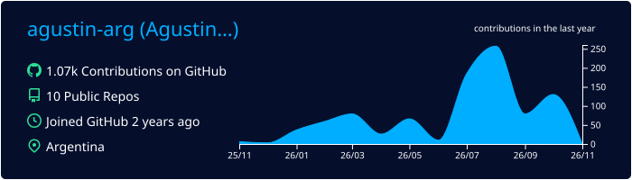
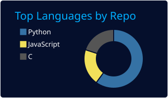
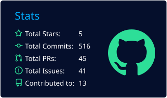

# 👋 Hola, soy Agustín

¡Bienvenido a mi GitHub! Soy apasionado por las ciencias de la computación, la inteligencia artificial y el desarrollo de software.

## 📌 Sobre Mí

- 📖 **Carrera**: Ingeniería en Computación  
- 📍 **Ubicación**: Argentina  
- 💼 **Posición Actual**: En modo aprendizaje constante  
- 💬 **Pregúntame sobre**: Bases de datos, Desarrollo de software, Tecnología, Aprendizaje    

## 🛠️ Habilidades y Tecnologías

Estas son algunas de las herramientas y tecnologías con las que me gusta trabajar:

- **Lenguajes**: Python.
- **Frameworks**: FastAPI.
- **Bases de datos**: MySQL y PostgreSQL.
- **Herramientas**: Git, GitHub y Docker.

## 📫 Contáctame

- 💼 [LinkedIn](https://www.linkedin.com/in/agustinalbertoleiva)  

---

¡Siéntete libre de explorar mis repositorios o contactarme si tienes alguna pregunta o quieres colaborar! 😄

## 📊 Estadísticas

\

